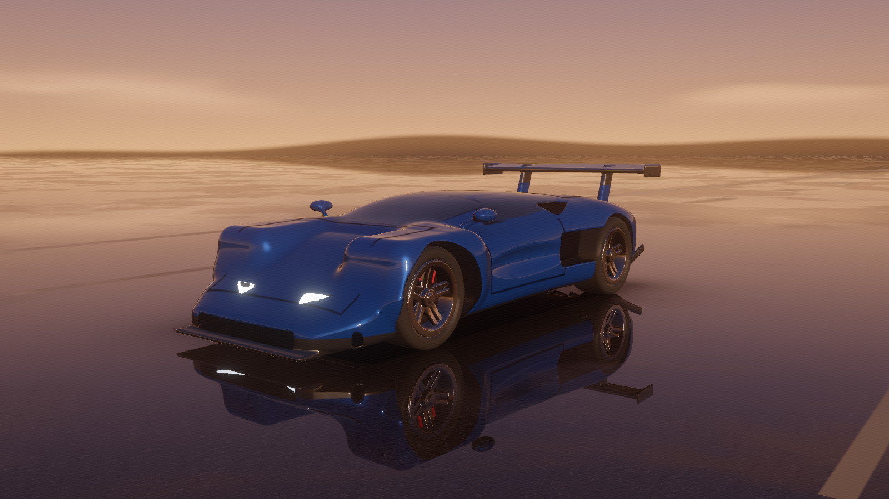
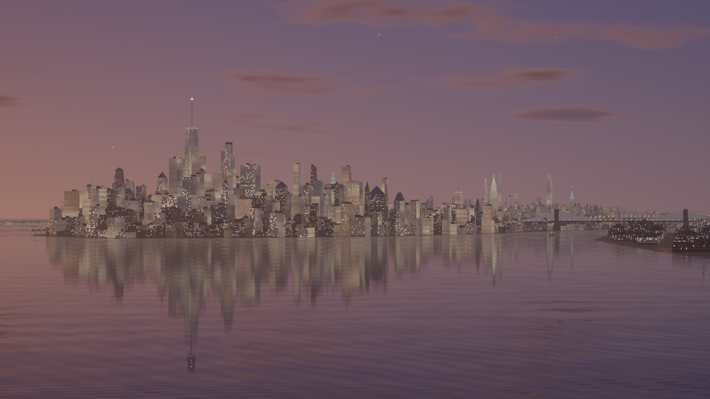
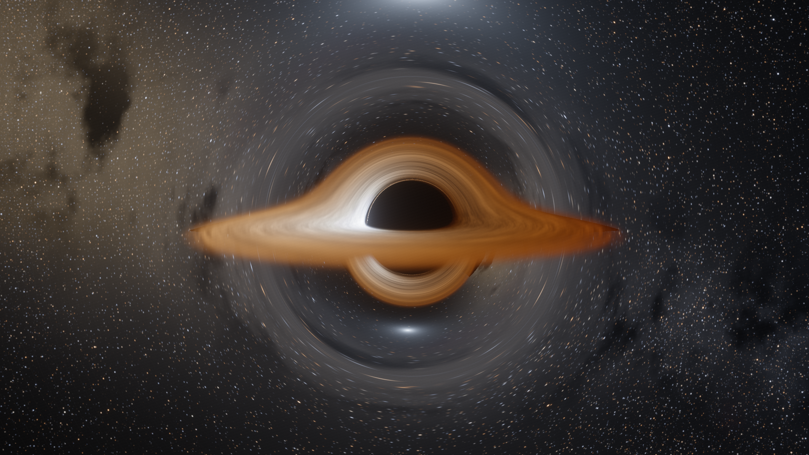
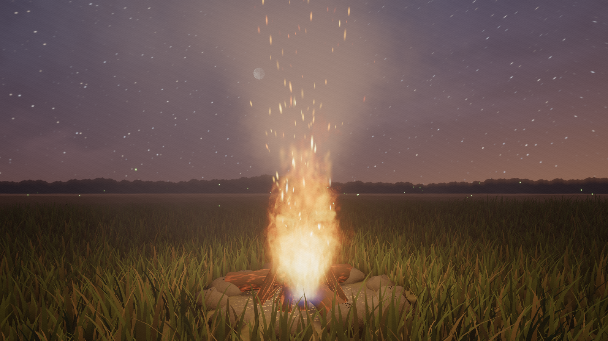

# web-scenes

Four real-time scenes written from scratch on WebGPU. No engine, no libraries. Layout and look follow [Noniv/web-ocean](https://github.com/Noniv/web-ocean) (MIT).

| Scene | Page | What it is |
|---|---|---|
| Supercar | `car.html` | Original "Vesper" hypercar, clearcoat paint, wet road at golden hour |
| New York | `city.html` | Manhattan skyline, golden hour to night, bridges and landmarks |
| Black hole | `space.html` | Per-pixel relativistic ray tracing, lensed accretion disc |
| Campfire | `fire.html` | Raymarched flame, sparks, smoke, lit grassland at dusk |

   

## Run

Recent Chrome with WebGPU. Open any file in `dist/` directly (`*.min.html` is the small build), or from source:

```
npm install
npm start      # http://localhost:8080/
npm run build  # regenerates dist/
```

Controls: click canvas for mouse look, WASD move, Space/E up, Q/C down, Shift fast, wheel speed/zoom, H settings panel. The car and black hole use an orbit camera (drag, wheel). URL params: `w`, `h`, `cam`, `fov`, `ui=0`, plus any slider key.

## Layout

`js/engine/` shared host (HDR, MSAA, bloom, AgX, cameras, panel, screenshots) · `js/scenes/<name>/` one folder per scene with its own `NOTES.md` · `js/scenes/_template` starting point · `tools/shot.mjs` headless screenshots.
